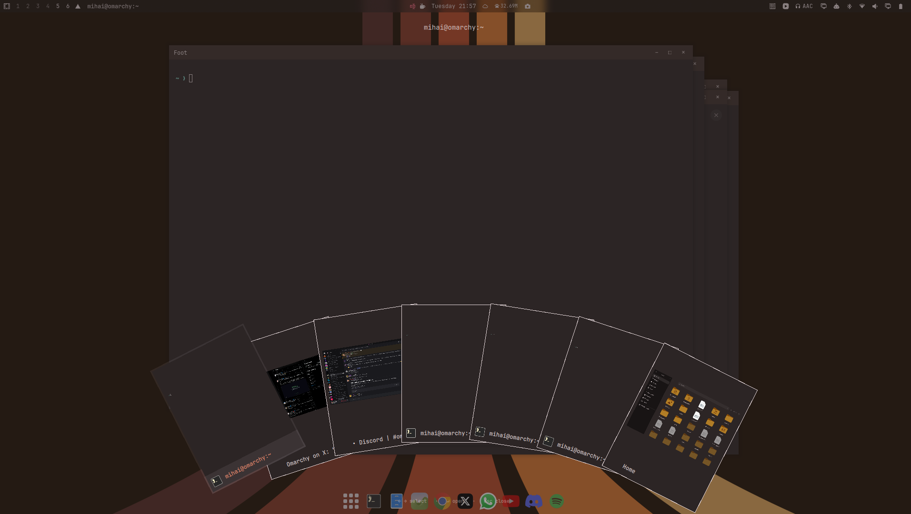

# mihai.cards

> Part of the **[Plugins](https://github.com/nightdevil00/Plugins)** collection.

A poker-style window switcher for Omarchy. A three-finger swipe up fans every open window out like a hand of cards, with a live thumbnail, the app icon, and the title on each card.



## Installing

```sh
git clone https://github.com/nightdevil00/Plugins.git
cd Plugins
./install.sh mihai.cards
```

Or copy it by hand. The install directory is named by the plugin **id**:

```sh
cp -r Plugins/mihai.cards ~/.config/omarchy/plugins/mihai.cards
omarchy plugin enable mihai.cards
omarchy restart shell
```

## Gesture

Add this to `~/.config/hypr/input.lua`, after the three-finger horizontal workspace gesture:

```lua
-- Three-finger swipe up fans the open windows out like a card hand.
hl.gesture({ fingers = 3, direction = "up", action = function() hl.exec_cmd("omarchy-shell shell summon mihai.cards '{}'") end })
```

Then run `hyprctl reload`.

## Usage

- Swipe up with three fingers to open
- `←` / `→` (or `Tab`) or hover to select a card
- `Enter` or click to focus that window
- `Esc` or click outside to close

## Notes

- Shows windows from every normal workspace. Special workspaces (scratchpads, negative IDs) are skipped. Focusing a window on another workspace switches to it.
- Thumbnails are live captures, so the overlay uses some GPU while open.
- Card size, fan spread, and bottom margin are the `Style.space(...)` values at the top of `Cards.qml`.
