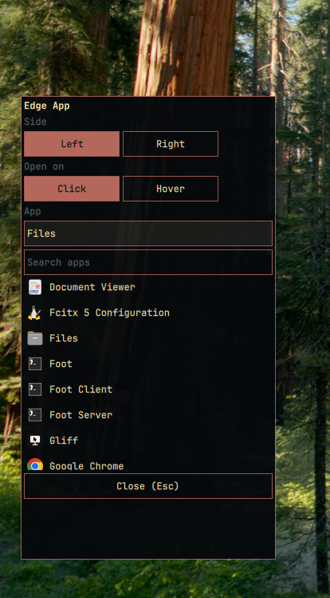
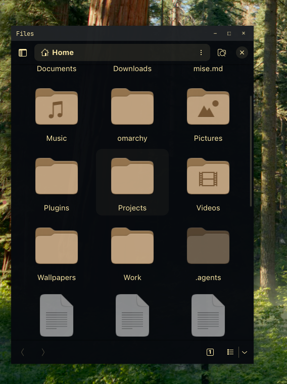
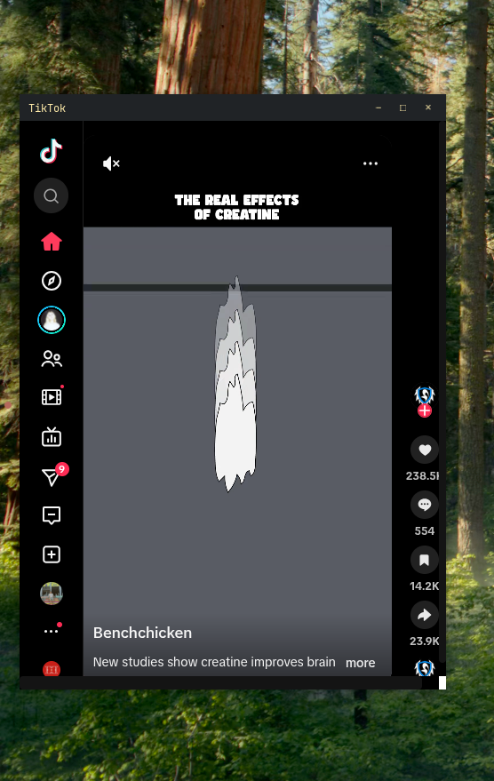

# Edge App

A small bullet on the left or right edge, halfway down the screen. It is
invisible until you hover it. Click it to slide out one pinned app beside it.
The app stays open until you press Escape or click the bullet again.







## Setup

The plugin is enabled by its entry in `~/.config/omarchy/shell.json`:

```json
{
  "plugins": [
    { "id": "mihai.edgeapp", "app": "org.gnome.Nautilus", "side": "right", "width": 480, "height": 640 }
  ]
}
```

| Key      | Default | Description                                  |
|----------|---------|----------------------------------------------|
| `app`    | none    | Desktop id of the app to pin (`foot`, `org.gnome.Nautilus`, ...) |
| `side`   | `right` | `left` or `right`                            |
| `width`  | `480`   | App window width in pixels                   |
| `height` | `640`   | App window height in pixels                  |
| `trigger`| `click` | `click` toggles the app; `hover` opens it when the pointer reaches the bullet |

Changes to `shell.json` apply on save. Restart the shell (`omarchy restart shell`)
after installing or moving the plugin.

## Usage

- Click the bullet (default): the app opens, launching it first if it is not running.
- With `trigger: "hover"`, reaching the bullet opens the app instead.
- Escape: tucks the app away (Escape is bound only while the app is open).
- Click the bullet while the app is out: tucks it away.
- Right-click the bullet: settings (side, trigger, app).

The app is parked on the `special:edgeapp` workspace while hidden, so it keeps
running in the background.

## Notes

- Escape is a global Hyprland bind added at runtime with `hyprctl eval` while
  the app is open, and removed when it closes. While the app is open, Escape
  inside it hides the app instead of reaching the app.
- Closing the app window clears the open state.
- Opening runs `hyprctl`, so the plugin depends on Hyprland's Lua config
  (Omarchy's default).
