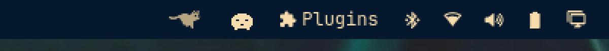

# RunCat

> Part of the **[Plugins](https://github.com/nightdevil00/Plugins)** collection — source: [`Plugins/mihai.runcat`](https://github.com/nightdevil00/Plugins/tree/main/mihai.runcat)

A running cat in the Omarchy bar, ported from the GNOME RunCat extension. The
cat runs faster as CPU usage rises and rests when the machine is idle. Left
click opens `btop` in your default terminal.



## Installing

```sh
git clone https://github.com/nightdevil00/Plugins.git
cp -r Plugins/mihai.runcat ~/.config/omarchy/plugins/mihai.runcat
omarchy-shell shell rescanPlugins
omarchy plugin enable mihai.runcat
omarchy bar move mihai.runcat --section right
```

## Credits

The running-cat sprites in `frames/` come from
[win0err/gnome-runcat](https://github.com/win0err/gnome-runcat) and are
licensed under GPL-3.0. This plugin is GPL-3.0 as well; see `LICENSE`.
